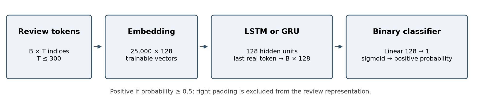
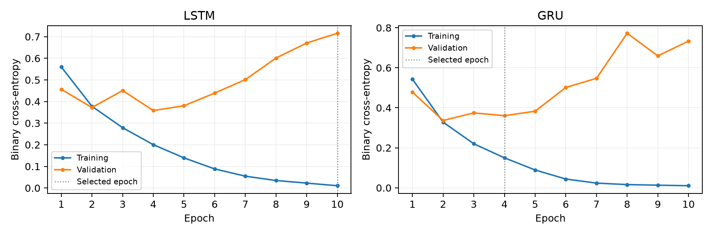
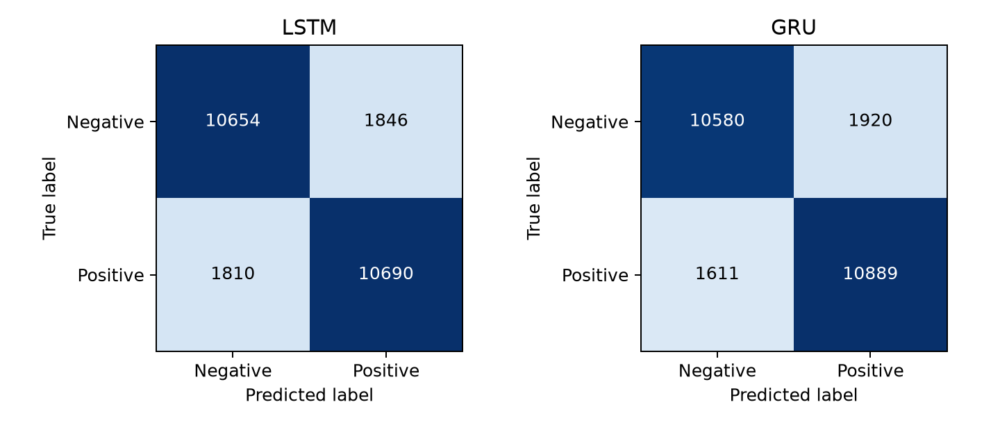

# Stage 4 movie classification with LSTM and GRU

Movie contribution by Andrew Toreja. These sections cover the LSTM and GRU experiments and are intended to be combined with Madison's RNN results and the team's joke-generation work.

## Section 1 Task Description

We classified IMDb movie reviews as positive or negative using recurrent neural networks. We extended the team's basic RNN with the two architectures required by Stage 4 step 4-5, LSTM and GRU, and compared their learning curves and held-out classification performance. Training settings and preprocessing were held constant between the two experiments.

## Section 2 Model Description

Figure 1. Shared classifier structure; B denotes batch size and T denotes the token sequence length.

Both models use the same sequence of operations: token indices → trainable 128-dimensional word embeddings → one unidirectional recurrent layer with 128 hidden units → linear layer with one output logit. The logit is converted to a positive-class probability with a sigmoid; a probability of at least 0.5 is classified as positive. Padding is excluded from the review representation by selecting each review's output at its true final token. Tests confirm that this representation agrees numerically with a packed-sequence implementation.

The LSTM uses input, forget and output gates together with a separate cell state to control the storage and retrieval of information across the review. The GRU uses update and reset gates with a single hidden state. These gates provide paths for retaining useful information across many tokens. They do not guarantee higher accuracy than a basic RNN; that comparison requires the RNN experiment. The LSTM has 3,332,225 trainable parameters and the GRU has 3,299,201, including the embedding and classifier.

## Section 3 Experiment Settings

### 3.1 Dataset Description

The professor-provided IMDb corpus contains 25,000 labeled training reviews and 25,000 labeled test reviews, each balanced between positive and negative sentiment. We reused the team's original NLTK cleaning, vocabulary building and PyTorch dataset loader. Cleaning removes HTML and URLs, expands negations, lowercases text and removes most stopwords while preserving negations and selected intensifiers. The training data are partitioned by the team's stratified split with seed 42: 22,500 reviews for training and 2,500 for validation. The official test set is kept separate.

The vocabulary is built from the training portion only, requires frequency at least three, and includes 25,000 entries with padding and unknown tokens. Each review retains its first 300 cleaned tokens. Validation and test words outside the training vocabulary are mapped to the unknown token. Labels are 0 for negative and 1 for positive. Both runs use the same encoded dataset, verified by its SHA-256 digest in the saved metrics.

### 3.2 Detailed Experimental Setups

Both models use 128-dimensional embeddings, 128 hidden units, one recurrent layer, no dropout, batch size 64, 10 epochs, Adam with learning rate 0.001, binary cross-entropy with logits, and gradient clipping at norm 1.0. The model initialization and training seed is 2. PyTorch default initialization is used, and the embedding vectors are learned from scratch. These settings match the corresponding hyperparameters in Madison's RNN script. A fixed seeded shuffle is used for training, and validation and test loaders do not shuffle.

The checkpoint with the highest validation accuracy is restored before test evaluation; ties retain the earliest epoch. The selected epochs were 10 for LSTM and 4 for GRU. The training ran on CPU using PyTorch 2.14.1 with 4 threads. Training and validation took 7.21 minutes for LSTM and 6.12 minutes for GRU. Test evaluation is excluded from these times.

### 3.3 Evaluation Metrics

Accuracy is the fraction of correctly classified reviews. For each class, precision is TP/(TP+FP), recall is TP/(TP+FN), and F1 is 2TP/(2TP+FP+FN). We report macro precision, recall and F1, obtained by calculating each metric separately for the negative and positive classes and averaging the two class values. Undefined precision or recall is assigned zero. Binary cross-entropy measures training and validation loss.

### 3.4 Source Code

Team repository: [RhinoTurtleCat Stage-4](https://github.com/sampelts/RhinoTurtleCat/tree/Stage-4). This local contribution adds the LSTM/GRU implementations and the shared training, evaluation, checkpointing and plotting workflow. The model, dataset, setting, evaluation and result components follow the provided source-code template. Commands and file locations are documented in `STAGE4_MOVIES.md`. The new contribution must be pushed to the team repository before the final submission so it is accessible through the source-code link.

### 3.5 Training Convergence Plot

Figure 2. Mean minibatch training cross-entropy and validation cross-entropy at each epoch. The dotted vertical line indicates the checkpoint selected by validation accuracy, which need not be the epoch with the lowest validation loss. Training loss is accumulated over minibatches as weights are updated; validation loss is evaluated after the epoch with fixed weights.

LSTM training loss decreased from 0.5600 to 0.0106. Validation loss reached its minimum of 0.3583 at epoch 4 and ended at 0.7159. Continued reduction in training loss alongside higher validation loss indicates overfitting after the best validation-loss epoch.
GRU training loss decreased from 0.5427 to 0.0106. Validation loss reached its minimum of 0.3364 at epoch 2 and ended at 0.7334. Continued reduction in training loss alongside higher validation loss indicates overfitting after the best validation-loss epoch.

### 3.6 Model Performance

| Model | Test accuracy | Macro precision | Macro recall | Macro F1 | Selected epoch | Parameters |
|---|---:|---:|---:|---:|---:|---:|
| LSTM | 85.38% | 0.8538 | 0.8538 | 0.8538 | 10 | 3,332,225 |
| GRU | 85.88% | 0.8590 | 0.8588 | 0.8587 | 4 | 3,299,201 |

Table 1. Each model is evaluated once on all 25,000 held-out test reviews after selecting its checkpoint using validation accuracy.

Figure 3. Confusion matrices with true labels on rows and predicted labels on columns. The negative and positive classes each contain 12,500 test reviews.

### 3.7 Architecture Comparison

The GRU exceeded the LSTM test accuracy by 0.50 percentage points. The GRU had the higher validation accuracy (87.76%). The GRU uses 33,024 fewer trainable parameters than the LSTM under the same embedding and hidden dimensions. The parameter difference is an inherent consequence of the different recurrent cells rather than a change in the shared training settings.

These are required architecture comparisons. This contribution does not add separate hyperparameter ablations or claim an improvement over the basic RNN without Madison's results. Because only one training seed was evaluated, differences describe these experiments and should not be treated as statistically established architecture rankings. The learning curves show the observed optimization and generalization behavior; loss is not required to decrease monotonically.
