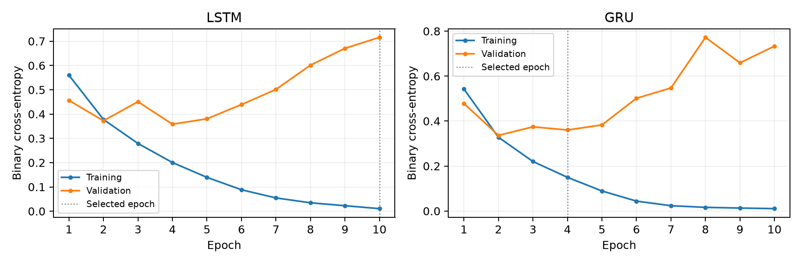
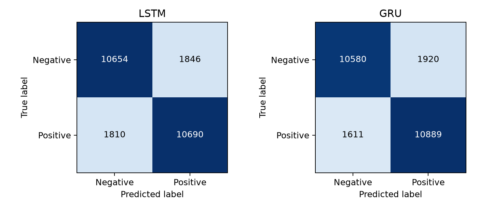

# Movie model comparison

Full held-out test results. Precision, recall and F1 are macro-averaged.

| Model | Accuracy | Precision | Recall | F1 | Selected epoch | Parameters |
|---|---:|---:|---:|---:|---:|---:|
| LSTM | 0.8538 | 0.8538 | 0.8538 | 0.8538 | 10 | 3,332,225 |
| GRU | 0.8588 | 0.8590 | 0.8588 | 0.8587 | 4 | 3,299,201 |

